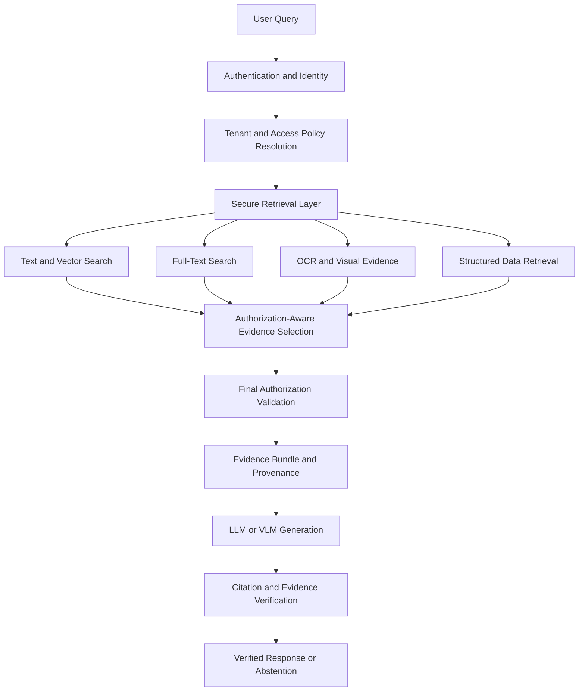

# SRAG — Secure Multi-Modal Evidence Retrieval

### Authorization-First AI. Evidence-Grounded Answers. Verifiable Provenance.

**SRAG (Secure RAG)** is a security-focused retrieval-augmented generation system designed to retrieve, authorize, and deliver evidence from multiple data modalities without exposing information a user is not permitted to access.

Unlike conventional RAG systems that primarily focus on retrieving relevant documents, SRAG treats **authorization as a fundamental constraint of retrieval and generation**.

The system is designed to work with enterprise knowledge containing text, tables, scanned documents, OCR-extracted content, images, and structured database records. Every piece of evidence must satisfy access-control policies before it can enter the language model's context.

> **Core Security Invariant**
>
> `FINAL_MODEL_CONTEXT ⊆ AUTHORIZED_EVIDENCE`
>
> The language model must never receive evidence that the requesting user is not authorized to access.

---

## Table of Contents

* [The Problem](#the-problem)
* [Our Approach](#our-approach)
* [Core Principles](#core-principles)
* [System Architecture](#system-architecture)
* [How SRAG Works](#how-srag-works)
* [Security Architecture](#security-architecture)
* [Multimodal Evidence Model](#multimodal-evidence-model)
* [Technology Stack](#technology-stack)
* [Implementation Status](#implementation-status)
* [Testing and Security Validation](#testing-and-security-validation)
* [Getting Started](#getting-started)
* [Configuration](#configuration)
* [Project Structure](#project-structure)
* [Design Decisions](#design-decisions)
* [Limitations and Roadmap](#limitations-and-roadmap)
* [Contributing](#contributing)
* [License](#license)

---

## The Problem

Retrieval-Augmented Generation (RAG) enables language models to answer questions using external knowledge instead of relying exclusively on their training data.

However, deploying RAG in environments containing sensitive or multi-tenant information introduces several challenges.

### 1. Retrieval does not equal authorization

A document can be highly relevant to a query but still be inaccessible to the user making that query.

A conventional similarity search does not inherently understand whether a user has permission to access a particular document, database row, or evidence fragment.

### 2. Access control must extend beyond the user interface

Hiding documents in a frontend is insufficient.

If unauthorized content reaches the retrieval pipeline, application logs, prompt construction, or language model, the system has already crossed a security boundary.

### 3. Enterprise knowledge is not exclusively textual

Important information can exist in:

* Digitally generated PDFs.
* Scanned documents and OCR-extracted text.
* Tables and structured records.
* Images and visual evidence.
* Relational databases.
* Documents containing a mixture of these formats.

A system that retrieves only plain text can overlook critical information or lose the relationship between evidence and its original source.

### 4. Generated answers need traceable evidence

A plausible answer is not necessarily a correct answer.

Enterprise users need to understand where information originated, which pages or records support a claim, and whether the available evidence actually supports the response.

### The objective

SRAG aims to combine secure retrieval, fine-grained authorization, multimodal evidence processing, and traceable generation into one coherent architecture.

---

## Our Approach

SRAG is built around a different design principle:

**Secure the evidence before generating the answer.**

Instead of treating authorization as an application-level filter applied after retrieval, SRAG is designed to enforce access policies within the data and retrieval layers.

The intended processing flow is:

1. Authenticate the requesting user.
2. Resolve the user's tenant and access identity.
3. Apply applicable authorization policies.
4. Retrieve relevant evidence from permitted sources.
5. Construct a structured evidence bundle with source provenance.
6. Validate the evidence before model-context construction.
7. Generate an evidence-grounded response.
8. Verify citations and evidence references.
9. Return a supported response or abstain when sufficient evidence is unavailable.

This architecture separates **finding relevant information** from **determining whether that information is allowed to be used**.

---

## Core Principles

### 1. Authorization before generation

Access decisions must be enforced before evidence reaches the language model.

Authorization cannot depend solely on prompt instructions, frontend restrictions, or the model's willingness to ignore sensitive information.

### 2. Tenant isolation

Each request must operate within the requesting user's authorized tenant boundary.

Database access is designed to use tenant-aware sessions and PostgreSQL Row-Level Security (RLS) to strengthen isolation between tenants.

### 3. Evidence-first generation

Generated answers should be grounded in retrieved evidence rather than unsupported assumptions.

The architecture includes structured evidence bundles and provenance information to support traceability.

### 4. Multimodal retrieval

The system is designed to process multiple evidence types while preserving their original source locations and access-control metadata.

### 5. Verifiable citations

Citations should identify actual evidence sources rather than relying on model-generated page numbers or fabricated references.

The target design includes deterministic validation of citations against retrieved evidence.

### 6. Fail-closed security

When authentication, authorization, or required security context cannot be validated, the system should deny access rather than silently continue with weaker protections.

### 7. Defense in depth

Security is enforced across multiple layers, including identity resolution, application-level authorization, database isolation, retrieval filtering, and final evidence validation.

No single layer should be treated as a substitute for the others.

---

## System Architecture

SRAG separates security enforcement, evidence retrieval, and language-model generation into distinct stages.



*The diagram represents the intended end-to-end architecture. Not every component is necessarily implemented or integrated in the current version.*

### Architecture components

| Component                      | Responsibility                                                         |
| ------------------------------ | ---------------------------------------------------------------------- |
| Authentication                 | Establish the requesting user's identity.                              |
| Identity and policy resolution | Determine tenant context and applicable access permissions.            |
| Secure database layer          | Enforce tenant isolation and database access policies.                 |
| Hybrid retrieval               | Combine semantic and lexical retrieval for relevant evidence.          |
| Multimodal ingestion           | Extract information from supported document and data formats.          |
| Evidence construction          | Package retrieved evidence with source and provenance metadata.        |
| Authorization validation       | Ensure selected evidence remains within the permitted access boundary. |
| Generation                     | Produce responses using the approved evidence supplied to the model.   |
| Citation verification          | Check citations against retrieved evidence and source metadata.        |
| Abstention                     | Avoid presenting unsupported conclusions as verified answers.          |

---

## How SRAG Works

### Stage 1 — Identity and authorization

Every request begins with an authenticated identity and the security context required for access decisions.

The system resolves the relevant tenant and applies authorization policies before protected evidence can be used.

Database operations are designed to preserve this context throughout the request lifecycle.

### Stage 2 — Evidence retrieval

SRAG uses a retrieval architecture based on PostgreSQL, `pgvector`, and PostgreSQL full-text search.

The objective is to combine:

* **Semantic retrieval:** Find evidence based on conceptual similarity.
* **Lexical retrieval:** Find evidence using matching words, terms, and identifiers.
* **Structured retrieval:** Access authorized database records.
* **Visual and OCR retrieval:** Retrieve evidence extracted from scanned or image-containing documents as the relevant ingestion components are integrated.

Retrieval relevance does not override authorization.

### Stage 3 — Evidence construction

Retrieved results are represented as structured evidence rather than untracked strings inserted directly into a prompt.

The evidence model is designed to preserve metadata such as:

* Source and document identifiers.
* Tenant and access-control context.
* Evidence modality.
* Page numbers and element identifiers.
* Bounding boxes and coordinate-system metadata where applicable.
* Provenance information.
* References needed to resolve citations.

This provides a foundation for traceable responses and downstream evidence validation.

### Stage 4 — Final authorization validation

Before the language model receives the evidence, the system must validate that the selected evidence satisfies the applicable access policies.

This is a critical security boundary.

An unauthorized result must not become acceptable merely because it was returned by a search engine, embedded in a cached result, or included in an intermediate retrieval object.

### Stage 5 — Evidence-grounded generation

The language model receives the authorized evidence selected for the request.

The model's task is to formulate an answer using that evidence, not to decide which users are allowed to access it.

The intended output includes source references that can be checked against the evidence supplied to the model.

### Stage 6 — Verification and response

The final stage is designed to validate citations and evidence references before presenting the response.

Where evidence is insufficient, the target behavior is to communicate that limitation rather than manufacture a supported-looking answer.

Citation validation does not independently prove that every generated statement is factually correct. It establishes a foundation for checking whether references correspond to real retrieved evidence.

---

## Security Architecture

Security is a primary system requirement, not an optional feature.

### The central invariant

```text
FINAL_MODEL_CONTEXT ⊆ AUTHORIZED_EVIDENCE
```

This expresses the requirement that every piece of evidence supplied to the final model context must belong to the set of evidence authorized for the requesting user.

The broader security objective is to prevent unauthorized information from propagating into model inputs, generated responses, and other protected output channels.

### Tenant-aware database access

The database layer uses PostgreSQL with `pgvector` and is designed to apply PostgreSQL Row-Level Security.

Tenant context is established through the secure request and database-session flow.

The security design aims to prevent cross-tenant reads and writes, including attempts to bypass normal application-level filtering.

### Fail-closed identity handling

Invalid or missing authentication context must not be treated as a trusted identity.

Security-sensitive operations should fail when the required identity or tenant context cannot be established.

### Authorization-aware retrieval

Retrieval must account for access policies rather than relying exclusively on vector similarity.

This is important because a semantically relevant result can still be unauthorized.

The implementation must ensure that retrieval filtering, database policies, and subsequent evidence validation work together.

### Evidence provenance

Evidence should retain sufficient source metadata to support traceability.

This is particularly important for multimodal sources, where a citation may need to refer to a PDF page, table element, OCR region, or visual region rather than an ordinary text chunk.

### Security validation

The test strategy includes tenant-isolation checks and negative tests intended to verify that unauthorized operations are rejected.

Security claims should be tied to executable tests and verified implementation behavior rather than inferred from architectural diagrams.

---

## Multimodal Evidence Model

SRAG is designed to extend beyond conventional text-only RAG.

| Evidence type               | Intended handling                                                                |
| --------------------------- | -------------------------------------------------------------------------------- |
| PDF text                    | Extract text and retain document and page references.                            |
| Tables                      | Preserve structured content and source-element references.                       |
| Scanned PDFs                | Extract text through OCR while retaining source-location metadata.               |
| Images                      | Associate visual evidence with its source and relevant metadata.                 |
| Structured database records | Retrieve records within applicable authorization boundaries.                     |
| Mixed-content documents     | Preserve relationships between extracted content and original document elements. |

### Evidence location and provenance

The multimodal pipeline is designed to preserve source-location information, including:

* Page numbers.
* Document element identifiers.
* Bounding boxes.
* Coordinate-system metadata.
* Visual reference identifiers where applicable.

These fields support a more precise relationship between retrieved evidence and its original source.

**Important:** Supporting a modality involves more than extracting its content. The complete pipeline must preserve authorization, provenance, retrieval behavior, and citation integrity for that modality.

---

## Technology Stack

The following table distinguishes the project's core implementation technologies from components whose integration depends on the current development phase.

| Technology                  | Purpose                                               |
| --------------------------- | ----------------------------------------------------- |
| Python                      | Core application and processing logic.                |
| FastAPI                     | Backend API and request handling.                     |
| PostgreSQL                  | Persistent relational storage and policy enforcement. |
| `pgvector`                  | Vector similarity search.                             |
| PostgreSQL Full-Text Search | Lexical retrieval.                                    |
| BGE-M3                      | Embedding generation for semantic retrieval.          |
| SQLAlchemy                  | Database access and session management.               |
| Alembic                     | Database schema migrations.                           |
| Docling                     | Document parsing and extraction pipeline.             |
| PaddleOCR                   | OCR processing for scanned or image-based content.    |
| Pytest                      | Automated testing.                                    |
| `structlog`                 | Structured application logging.                       |

Additional language-model, vision-model, reranking, and frontend integrations should be documented with their actual providers and configurations once their integration is verified.

---

## Implementation Status

SRAG is an actively developed project. The architecture describes the intended complete system, while the following status summary reflects the latest recorded development state available for this README.

| Component                                             | Recorded status                                     |
| ----------------------------------------------------- | --------------------------------------------------- |
| FastAPI backend foundation                            | Implemented                                         |
| Authentication and identity foundation                | Implemented                                         |
| Secure database-session foundation                    | Implemented                                         |
| PostgreSQL and `pgvector` retrieval foundation        | Implemented                                         |
| BGE-M3 embedding integration                          | Implemented                                         |
| PostgreSQL full-text retrieval foundation             | Implemented                                         |
| Tenant-aware access-control foundation                | Implemented                                         |
| Database Row-Level Security foundation                | Implemented                                         |
| PDF and document-processing pipeline                  | Developed                                           |
| OCR and multimodal ingestion                          | Under development and testing                       |
| Evidence bundle and provenance contracts              | Developed                                           |
| Citation integration and verification                 | Under development                                   |
| Complete end-to-end multimodal retrieval              | Requires current integration verification           |
| Full claim-level verification and abstention pipeline | Target capability; completion requires verification |

These statuses are based on previously recorded project progress, not a fresh inspection of the current repository. They should be reconciled against the latest code and test results before being treated as a release checklist.

---

## Testing and Security Validation

Testing is essential because a RAG system can appear to work correctly while violating access-control boundaries.

The project has previously recorded a passing foundation test suite, including **31 passing tests at one development checkpoint**. A broader project summary also referenced 40 tests. These are historical figures, not a claim about the current branch.

The current test count and results should be confirmed by running the suite in the active environment.

### Security properties to validate

* Invalid authentication context is rejected.
* Tenant identity is propagated through protected database operations.
* Cross-tenant reads are denied.
* Cross-tenant writes are denied.
* Unauthorized evidence is excluded from model context.
* Evidence provenance survives ingestion and retrieval.
* Citations reference actual source metadata.
* Missing or insufficient evidence does not result in a falsely verified response.

### Recommended security test scenarios

| Scenario                                           | Expected behavior                                                 |
| -------------------------------------------------- | ----------------------------------------------------------------- |
| User requests an authorized document               | Return permitted evidence.                                        |
| User requests another tenant's document            | Deny access or return no unauthorized evidence.                   |
| User attempts to bypass application filtering      | Database and retrieval controls must still enforce authorization. |
| Authentication token is invalid                    | Reject the request.                                               |
| Evidence lacks required authorization context      | Fail closed.                                                      |
| Citation references a nonexistent evidence element | Reject or flag the citation.                                      |
| Retrieval finds insufficient supporting evidence   | Abstain or clearly report insufficient evidence.                  |

These scenarios describe the required security behavior; each must be verified against the current implementation.

---

## Getting Started

### Prerequisites

The development environment is expected to include:

* Python.
* PostgreSQL.
* The `pgvector` PostgreSQL extension.
* Git.
* Access to any external model provider required by the configured application.

Exact version requirements and optional dependencies should be taken from the repository's dependency files.

### 1. Clone the repository

```bash
git clone <YOUR_REPOSITORY_URL>
cd <YOUR_REPOSITORY_DIRECTORY>
```

Replace the placeholders with the actual repository URL and directory name.

### 2. Create a virtual environment

**Windows PowerShell**

```powershell
python -m venv .venv
.\.venv\Scripts\Activate.ps1
```

**Linux/macOS**

```bash
python3 -m venv .venv
source .venv/bin/activate
```

### 3. Install dependencies

If the repository provides a `requirements.txt` file:

```bash
python -m pip install --upgrade pip
pip install -r requirements.txt
```

If the project uses another dependency manager or lockfile, follow the repository's documented installation process instead.

### 4. Configure environment variables

Create a local `.env` file if the application supports it.

Use the actual variable names defined in the project's settings module or environment template. Do not assume that illustrative variable names below are supported by the current code.

```dotenv
DATABASE_URL=<YOUR_DATABASE_CONNECTION_STRING>
```

Configure any additional authentication, embedding, or model-provider settings required by the current implementation.

**Security note:** Never commit production credentials, API keys, signing secrets, or sensitive database connection strings to version control.

### 5. Initialize the database

Configure PostgreSQL and the required `pgvector` extension.

Apply the project's actual database migrations using the migration configuration provided by the repository. If Alembic is configured, the migration command may be:

```bash
alembic upgrade head
```

Run this only after confirming that the migration configuration and target database are correct.

### 6. Start the backend

If the application entry point is `app.main:app` and it exposes a FastAPI application:

```bash
uvicorn app.main:app --reload
```

If the entry point differs in the current branch, substitute the correct module path.

### 7. Run tests

If Pytest is configured:

```bash
pytest -q
```

Review the results before assuming that the application is ready for use.

> **Setup status:** The commands above are a generic starting point based on the recorded stack. Exact environment variables, database initialization, server entry points, and dependency instructions must be checked against the current repository before this section is considered fully verified.

---

## Configuration

Configuration should be handled through the project's settings layer and environment variables rather than hardcoded secrets.

Typical configuration categories include:

| Category            | Configuration purpose                                     |
| ------------------- | --------------------------------------------------------- |
| Database            | PostgreSQL connection and pooling.                        |
| Authentication      | Token validation and identity resolution.                 |
| Tenant isolation    | Trusted tenant context and database policy configuration. |
| Embeddings          | Model selection and embedding dimensions.                 |
| Retrieval           | Search configuration and retrieval limits.                |
| Document processing | Supported formats and extraction settings.                |
| Generation          | Model provider and generation parameters.                 |
| Logging             | Structured logging and security-event handling.           |

Use the repository's actual settings definitions as the source of truth for supported variables and default values.

---

## Project Structure

The following is a conceptual organization of the major responsibilities. It is not a verified listing of the current repository's directory tree.

```text
SRAG/
├── app/
│   ├── main.py
│   ├── settings.py
│   ├── authentication/
│   ├── database/
│   ├── security/
│   ├── ingestion/
│   ├── retrieval/
│   ├── evidence/
│   ├── generation/
│   └── verification/
├── tests/
│   ├── unit/
│   ├── integration/
│   └── security/
├── alembic/
├── docs/
├── .env.example
├── requirements.txt
└── README.md
```

Directory names should be adjusted to match the actual codebase. The architecture should guide the organization without creating the impression that planned modules already exist.

---

## Design Decisions

### Why PostgreSQL and `pgvector`?

Combining relational storage, vector search, and PostgreSQL's full-text capabilities provides a foundation for integrating semantic retrieval with metadata-aware filtering and database-level security.

It also allows access-control policies to be enforced closer to the underlying data.

However, database-level security does not automatically secure every retrieval path. Connection pooling, transaction state, tenant-context propagation, query construction, and privileged database roles must all be handled correctly.

### Why authorization before the LLM?

Language models are not access-control systems.

Once unauthorized information enters a model's context, downstream instructions and output filtering cannot reliably undo that exposure.

SRAG therefore places authorization before generation and treats the final model context as a security boundary.

### Why structured evidence bundles?

Unstructured prompt strings make it difficult to track where evidence originated or to validate whether citations refer to real sources.

Structured evidence bundles establish a clearer contract between retrieval, generation, and verification.

### Why multimodal provenance?

A sentence extracted from a scanned page, a table cell, and a region of an image have different source-location requirements.

Preserving modality-specific provenance enables more precise evidence references and creates a foundation for auditing generated answers.

---

## Limitations and Roadmap

SRAG is under active development. The following roadmap describes target capabilities, not a guarantee that each item has already been implemented.

### Phase 1 — Secure retrieval foundation

* [x] FastAPI backend foundation.
* [x] Authentication and identity foundation.
* [x] PostgreSQL and vector-retrieval foundation.
* [x] Embedding integration.
* [x] Tenant-aware access-control foundation.
* [x] Initial security tests.

### Phase 2 — Multimodal ingestion and evidence

* [x] Document-processing foundation.
* [x] Evidence and provenance contracts.
* [ ] Complete OCR and visual-evidence integration.
* [ ] End-to-end validation of all supported modalities.
* [ ] Verified source-location citations across evidence types.

### Phase 3 — Verified generation

* [ ] Complete evidence-bundle integration with generation.
* [ ] Deterministic citation validation.
* [ ] Claim-to-evidence association.
* [ ] Unsupported-claim detection.
* [ ] Evidence-aware abstention.
* [ ] End-to-end validation of the final model context.

### Phase 4 — Security hardening

* [ ] Expanded adversarial and cross-tenant testing.
* [ ] Retrieval and cache isolation validation.
* [ ] Database connection-pooling security tests.
* [ ] Authorization regression tests.
* [ ] Security audit and failure-mode analysis.

### Phase 5 — Evaluation and deployment

* [ ] Retrieval-quality benchmarks.
* [ ] Authorization-leakage test suite.
* [ ] Latency and resource-use evaluation.
* [ ] Reproducible deployment configuration.
* [ ] Operational monitoring and auditability.

The roadmap should be updated as features are implemented, tested, and verified.

---

## Contributing

Contributions should preserve SRAG's security invariants and architectural boundaries.

When contributing:

1. Understand the existing implementation before changing it.
2. Preserve tenant and authorization context throughout the request lifecycle.
3. Do not pass unvalidated evidence to generation.
4. Add tests for security-sensitive behavior.
5. Avoid claiming support for a modality until its ingestion, retrieval, authorization, and provenance paths are validated.
6. Document limitations and known failure modes.
7. Verify changes with the relevant test suite.

Changes that weaken authorization guarantees should not be accepted merely because they improve retrieval speed or answer quality.

---

## License

Add the project's chosen license here after confirming the repository's licensing terms.

If this project is built on top of an existing repository, preserve applicable upstream copyright notices and license obligations.

---

## Enterprise dataset (EnterpriseRAG-Bench)

[EnterpriseRAG-Bench](https://github.com/onyx-dot-app/EnterpriseRAG-Bench) (MIT) supplies
~500k simulated internal documents for a fictional company, plus 600 questions with gold
answers and the document ids each should retrieve. The corpus carries no permissions of its
own, so the adapter derives an ACL from the source system each document came out of.

```bash
python scripts/download_enterprise_bench.py          # subset only, via range requests
python scripts/ingest_enterprise_bench.py            # into the benchmark tenant
python scripts/eval_enterprise_bench.py              # recall and ACL enforcement
```

The download reads the 1.2GB `all_documents.zip` index remotely and fetches only what is
needed: every document a question expects, plus a bounded distractor sample per source.
Ingestion goes through the normal `IngestService` path, so parsing, chunking, embedding and
tenant stamping are identical to an HTTP upload.

Scope mapping (`src/srag/datasets/enterprise_bench.py`): `github`/`jira`/`linear` require
collection `engineering`, `hubspot` requires `sales`, `confluence`/`google_drive` require
`docs`; `slack`/`gmail`/`fireflies` stay open, with some distractors restricted to `admin`.
An unrecognised source fails closed. Gold documents are never admin-restricted, so an
evaluation stays reproducible without an admin token. Personas `demo_bench_engineer`,
`demo_bench_sales` and `demo_bench_admin` differ by collection, not only by role.

### Demo

Start the API and the Vite app, then switch identity in the sidebar between **Bench
engineer**, **Bench sales** and **Bench admin** and ask the same question:

> What are the default per file and total request size limits for multipart uploads?

The engineer gets `The default per-file limit is 10 MiB and the default total request limit
is 50 MiB.` with a citation to `dsid_ae068ee4aa9640159427cd941bef0238` — exactly the document
`questions.jsonl` lists under `expected_doc_ids` for that question. The sales persona gets
`No authorized evidence`, worded identically to the case where the document does not exist,
so an answer cannot be used to probe for hidden documents.

### Measured results

2,163 ingested documents / 19,577 evidence units, BGE-M3 on a GPU, 60 scored questions
(`scripts/eval_enterprise_bench.py --top-k 10 --limit 60`):

| Persona | recall@10 | Leaks |
| --- | --- | --- |
| admin (bypasses scope) | 0.92 | 0 |
| engineer (`engineering`) | 0.63 | 0 |
| sales (`sales`) | 0.35 | 0 |

`cross_tenant_leaks=0`. Every returned hit is re-checked against `role_allows` independently
of the retrieval engine, so the harness exits non-zero if evidence reaches a persona not
entitled to it. The scoped personas score lower because gold documents they are not entitled
to are withheld — the control working, not a retrieval defect.

Limitations: the ingested corpus is a subset, not all ~500k documents, and the figures score
60 of the 500 questions; answer correctness is not graded automatically (only retrieval and
provenance); the benchmark data must never be used as training data (it carries a canary
GUID); and retrieval latency is dominated by the database, not the model — roughly 3.6s per
hybrid search against a remote pooler versus 21ms to embed the query on the GPU.

## Embeddings and device

`EMBEDDER_PROVIDER=local` uses BGE-M3 (1024-dim, matching the `evidence_units.embedding`
column). `EMBEDDER_DEVICE` is `auto` (CUDA when usable, else CPU), `cpu`, or `cuda`, which
fails loudly rather than falling back silently. On CUDA the model loads in fp16, since fp32
weights are 2.3GB and leave a 4GB card no room for activations; `EMBEDDER_BATCH_SIZE` bounds
that further. Ingest and query must use the same provider — BGE-M3 and hashing vectors do not
share a space. A CPU-only torch build makes BGE-M3 roughly 30x slower, so `EMBEDDER_DEVICE=cuda`
is the way to find out before throughput tells you.

Database connections go through `create_engine_from_settings` (`src/srag/db/session.py`)
rather than `create_async_engine`: asyncpg enables `TCP_NODELAY` but never `SO_KEEPALIVE`, so
a connection held across a long embedding pass can be dropped by a NAT or firewall and the
next statement fails with `connection was closed in the middle of operation`. That factory
turns keepalives on, bounds reuse with `pool_recycle`, and pre-pings on checkout. Tunables:
`DB_KEEPALIVE_IDLE`, `DB_KEEPALIVE_INTERVAL`, `DB_KEEPALIVE_COUNT`, `DB_POOL_SIZE`,
`DB_MAX_OVERFLOW`, `DB_POOL_RECYCLE`, `DB_POOL_TIMEOUT`, `DB_COMMAND_TIMEOUT`.

---

## Final Note

SRAG is built around a fundamental principle:

**An AI system should not answer a question using evidence the requesting user is not authorized to access.**

By treating authorization, evidence provenance, and retrieval correctness as first-class architectural concerns, SRAG aims to provide a foundation for building more secure, auditable, and evidence-grounded AI systems.

The goal is not simply to retrieve relevant information and generate an answer. It is to retrieve the right evidence, enforce the right permissions, and establish a verifiable connection between the evidence and the response.
